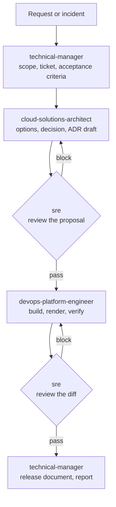

# DevOps as a Service agent team

Four agents that cover a DevOps managed-services engagement end to end: intake,
architecture, build, and review. Vendor-agnostic and client-agnostic. They carry
no platform facts of their own.

This team applies the organizing rule from
[`../docs/product-team.md`](../docs/product-team.md), and diverges from it in one
place. Read [the divergence](#the-divergence-two-deciders-not-one) before adding
a role.

## The team

| Role | Tier | Decides, reviews or builds | Owns | Refuses |
|------|------|----------------------------|------|---------|
| [technical-manager](./technical-manager.md) | Long-reasoning | **Decides** scope and release readiness | The request brief, acceptance criteria, the release document, the report | An acceptance criterion nobody can observe, and any claim that a check passed when it was not run |
| [cloud-solutions-architect](./cloud-solutions-architect.md) | Long-reasoning | **Decides** technical shape | The architecture record and every ADR. The only role that may change a technical constraint | To record a decision without a named reversal condition, or to recite a framework pillar from memory |
| [devops-platform-engineer](./devops-platform-engineer.md) | Mid | Builds | Terraform, Helm, Kubernetes manifests, GitOps config, CI, observability wiring | A version number written from memory, and a claim that an unrun command passed |
| [sre](./sre.md) | Long-reasoning | Reviews | The blast-radius verdict on another role's work | A change whose rollback path is unnamed, and a disruption claim with no named consumer or window |

Tiers map to models through the table in [`../AGENTS.md`](../AGENTS.md).

## The organizing rule, and where this team sits in it

**Exactly one role decides per decision boundary. Every other role reviews or
builds.**

The builders hold no decisions, and that is correct. The SRE holds veto over
specific classes of mistake: breaking the platform, breaking a stated rule,
adding a risk with no retirement condition, or disrupting service without
declaring where. It cannot substitute a different design. When a reviewer and a
decider disagree on direction rather than on a defect, the operator decides and
the outcome becomes an ADR.

### The divergence: two deciders, not one

[`../docs/product-team.md`](../docs/product-team.md) deliberately creates no
product manager, on the grounds that there is "no decision boundary that the
architect does not already hold". That holds for a product. It does not hold for
a client engagement, which has a second boundary the architect never owns:

| Boundary | Decider | Question it settles |
|---|---|---|
| Scope and delivery | technical-manager | Is this request in scope, in what order, and is it releasable yet |
| Technical shape | cloud-solutions-architect | What gets built, on what, and which decision is recorded |

The two never overlap. The technical manager does not choose a technology, and
the architect does not decide whether the client's request is in scope. Where
they appear to collide, the collision is a scope question wearing a technical
costume, or the reverse, and naming which one it is settles it.

This is one extra decider than the product roster, and it is justified by the
engagement context, not by preference. If an engagement has no commercial scope
boundary, drop the technical manager and let the architect hold both.

## Why four and not seven

A role earns an agent when it owns an artifact and passes a gate that can fail.
Backend, frontend, and fullstack work is covered by each repo's own test suite,
so an agent there adds a wrapper and no gate. Add one when a specific mistake
repeats, never before.

## Every reviewer carries two tables

From [`../AGENTS.md`](../AGENTS.md): a reviewer without them re-reports resolved
findings on every run, and a report that is mostly noise gets skipped, which is
worse than no reviewer at all.

| Table | Content | Where it lives |
|---|---|---|
| Already fixed, do not re-report | Findings closed, with the commit or change that closed them | the project's `CLAUDE.md` or a file it names |
| Known and accepted | Findings the operator accepted, with the reason and the condition that reopens them | same |

This applies to the SRE on every run, and to the architect when it reviews an
existing or inherited system.

## How the facts stay out of the agents

Every agent reads the client's `CLAUDE.md` for platform facts: blast-radius
layers, placeholder convention, forbidden patterns, environments and promotion
order, verification commands, documentation locations. See
[`../templates/CLAUDE.md`](../templates/CLAUDE.md).

An agent that states a platform fact instead of reading one rots on the first
change to that platform. The rule each agent carries is: **say where to look,
never what is true.**

If `CLAUDE.md` is missing or a required section is empty, the agent names the
section it needs and stops. It does not guess.

## The flow



The SRE appears twice on purpose. Reviewing a proposal is cheap and catches
shape errors. Reviewing a diff is the only thing that catches what the build
actually did.

Small changes skip the architect. A change that introduces a technology, crosses
a trust boundary, or alters a blast-radius layer does not.

## Running them solo

One operator wears all four hats, so the agents are four lenses rather than four
people. Two rules follow.

**The SRE always runs as a separate invocation with fresh context.** It reads the
diff, the client `CLAUDE.md`, and the live platform read-only. It never inherits
the authoring session. An SRE that shares the builder's context agrees with the
builder, and with one operator there is no second person to disagree.

**No agent assumes an access tier.** The operator holds the credentials. An agent
that needs a privileged action names the command and stops.

Invocation order for a typical change:

```text
1. technical-manager            scope the request, write acceptance criteria
2. cloud-solutions-architect    only if the change needs a decision
3. sre                          review the proposal          (fresh context)
4. devops-platform-engineer     build it
5. sre                          review the diff              (fresh context)
6. technical-manager            release document and report
```

## Install

Agents load from `.claude/agents/` in a project, or `~/.claude/agents/` for every
project. Symlink so one copy serves every client and updates land everywhere:

```bash
# per project
mkdir -p .claude/agents
ln -s "$PWD/../ai-software-engineering/agents"/*.md .claude/agents/

# or globally
mkdir -p ~/.claude/agents
ln -s ~/Work/ai-software-engineering/agents/*.md ~/.claude/agents/
```

Copy instead of symlink only when a client repo must be self-contained. A copy
forks; budget for that before choosing it.

## Adoption order

Each step is useful before the next exists.

1. **Fill in the client's `CLAUDE.md`.** Blast-radius layers, forbidden patterns,
   environments, verification commands. Without it no agent has anything to
   read, and three of the four stop on their first gate.
2. **Add the SRE.** It is the role whose absence costs the most on a platform
   that is already running, and its findings are the most concrete.
3. **Add the devops-platform-engineer.** The documentation currency gate starts
   paying immediately on any platform with a pinned version anywhere.
4. **Add the cloud-solutions-architect.** Record the decisions that already
   exist implicitly in the infrastructure. Most platforms have five to ten.
5. **Add the technical-manager** when the engagement has a scope boundary worth
   defending, which is usually the moment a second stakeholder starts making
   requests.

## Shared rules

Every agent carries these. They are repeated in each definition so an agent
loaded on its own still holds them.

| Rule | Why |
|------|-----|
| Cite or do not claim | Every claim names a `file:line`, a command and its output, or a first-party URL |
| Never describe an unrun command as passing | State what ran and what still needs the operator |
| Never commit, push, or apply | Prepare the change, draft the message, stop |
| Follow [`../guidelines/writing-style.md`](../guidelines/writing-style.md) | One voice across every client deliverable |
| Say where to look, not what is true | Facts belong in the client's `CLAUDE.md`, not in an agent |
